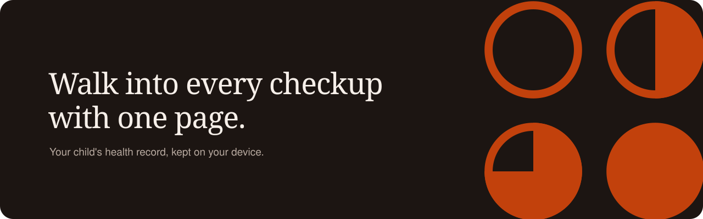

<p align="center">
  <picture>
    <source media="(prefers-color-scheme: dark)" srcset=".github/assets/logo-dark.svg">
    
  </picture>
</p>

<p align="center">
  The health record you keep for your kids, and one page for every pediatric visit.
</p>

<p align="center">
  
</p>

---

## What it does

Between checkups a lot happens: a fever at 2am, an urgent care visit, a new antibiotic, a rash after a daycare snack. Mira keeps it all in one place and, before each appointment, turns everything since the last visit into a single page for the pediatrician.

- **Timeline.** Log symptoms, illnesses, reactions, medications, measurements and notes in a few seconds, per child.
- **Visits.** Upcoming and past appointments, with a brief that fills in as the next visit gets closer.
- **Visit brief.** One printable page: what changed since the last visit, allergies and current medicines, vaccines due, and your questions in order.
- **Health.** Allergies, medicines, conditions and vaccines for each child.
- **Whole family.** Track several children from one home screen.

## Private by design

- No account, email or password.
- Records stay in the browser on your device (IndexedDB). Nothing is uploaded to a server.
- Encrypted backup files you save yourself and can restore on any device.
- Works offline and installs to the home screen as a PWA.

## Tech

React 19 · TypeScript · Vite · React Router · Remotion (landing page animations) · vite-plugin-pwa

## Getting started

Requires Node 20 or newer.

```bash
npm install
npm run dev
```

The landing page is at `/` and the app is at `/app`. On first visit the app loads an example family so you can see what it looks like with a few months of history; **Start my own record** clears it.

| Script | What it does |
| --- | --- |
| `npm run dev` | Start the dev server |
| `npm run build` | Type-check and build to `dist/` |
| `npm run preview` | Serve the production build locally |
| `npm run typecheck` | Type-check only |

## Project structure

```
src/
  landing/     Landing page and its Remotion compositions
  pages/       App screens (home, timeline, visits, health, brief, settings)
  components/  Shell, brand marks, backup, child switcher
  lib/         Store, IndexedDB, backup encryption, sample data, dates
brand/         Logo, mark and brand kit
```

## Disclaimer

Mira records what your family notices and hands it to your doctor. It is not medical advice and never interprets symptoms or suggests treatment.
